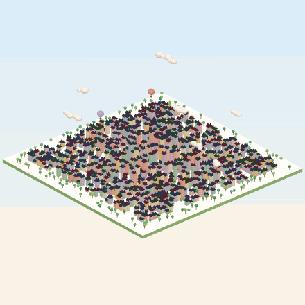
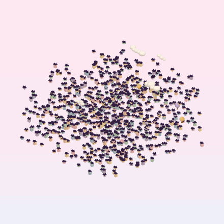

# Magic QR 3D

[English](README.md) · **Italiano**

Un piccolo quartiere 3D che sembra una normale città in miniatura… finché non lo tocchi.
La scena ruota dolcemente fino all'unica angolazione in cui tutti i tetti si allineano e formano un **QR code che si può scansionare**.

<p align="center">
  
  
</p>

Provalo: **https://giovannibishara.github.io/magic-qr-3d/** <!-- aggiorna se il tuo nome utente GitHub è diverso -->

## Cosa fa

- Scrivi un testo o un link: il QR viene creato nel browser con correzione d'errore **H** (si legge anche se è rovinato fino al 30%).
- Ogni quadratino scuro del QR diventa un edificio. Di lato è una città (o una nuvola di casette sospese); dall'alto è un QR piatto e nitido.
- **Tocca / clicca** la scena → ruota fino alla vista magica. Tocca di nuovo → torna in 3D. **Trascina** per girarla (con inerzia); se lasci il dito vicino alla vista dall'alto, si aggancia da sola.
- 3 forme (casette con porte, fioriere e comignoli; grattacieli con negozi; cubi), 2 disposizioni (città su una base, sospesa), 6 temi di colore, "rimescola" per altezze nuove.
- Alberi, nuvole che passano e mongolfiere animano la vista 3D, poi si rimpiccioliscono avvicinandosi alla vista magica, così non coprono mai il codice. Quando appare il QR le casette fanno un saltello (solo in su e in giù, quindi il codice resta leggibile).
- Esportazione: **PNG** della vista magica (pronto da stampare, 1600 px), **GIF** in loop, breve **video** (MP4 o WebM, dipende dal browser).
- Link condivisibili: tutte le scelte finiscono nell'indirizzo, per esempio `?text=https://example.com&shape=cubi&layout=sparsa&theme=lago`.
- Fluido sui telefoni: tutti gli edifici sono disegnati con due `InstancedMesh` (due sole chiamate di disegno) e la pagina ridisegna solo quando qualcosa si muove.
- Interfaccia in italiano e inglese. Nessuna compilazione, nessun tracciamento.

## Come funziona

La telecamera è **ortografica** (senza prospettiva). Con una telecamera ortografica che guarda dritta in basso, tutti i punti sulla stessa verticale finiscono sullo stesso pixel. Quindi ogni edificio può avere qualsiasi altezza, o fluttuare a qualsiasi quota, e dall'alto il suo tetto copre comunque esattamente il suo quadratino del QR.

Da qualsiasi altra angolazione le altezze diverse mescolano il disegno e il codice non si legge. Ogni tetto copre un modulo intero (1 × 1), i tetti sono scuri e il terreno è chiaro, quindi la vista dall'alto è un QR standard con il suo bordo bianco di 4 moduli.

```
modulo del QR (riga r, colonna c) ──► edificio in x = c, z = r, con altezza / quota casuale
vista magica = inclinazione 90°, rotazione 0°  ──► tetti = QR
```

`test.html` lo controlla in automatico: per ogni forma × disposizione × tema disegna la vista magica e la decodifica con [jsQR](https://github.com/cozmo/jsQR); controlla anche che da una vista inclinata il codice **non** si legga.

## Avviarlo sul computer

Serve [Node.js](https://nodejs.org) (solo per il piccolo server locale; la pagina in sé è statica).

```bash
npm start
```

Apri `http://localhost:5050`. Il terminale mostra anche un indirizzo tipo `http://192.168.x.x:5050` da aprire sul telefono collegato alla stessa Wi-Fi.

Per aggiornare le librerie in `vendor/`: `npm install` e poi `npm run vendor`.

## Pubblicarlo su GitHub Pages

Repository → **Settings** → **Pages** → *Deploy from a branch* → `main` / `(root)` → **Save**.
Dopo un minuto il sito è su `https://<nome-utente>.github.io/magic-qr-3d/`.

## Struttura

```
index.html        pagina e comandi
css/style.css     impaginazione (pannello dal basso sul telefono, laterale su computer)
js/scene.js       scena three.js, telecamera, tocco, animazioni
js/qr.js          testo → matrice del QR
js/decor.js       alberi, nuvole, mongolfiere
js/themes.js      temi di colore
js/export.js      esportazione PNG / GIF / video
js/i18n.js        testi in italiano e inglese
test.html         test automatico di lettura
scripts/          server locale e script per le librerie
vendor/           three.js, qrcode-generator, gifenc, jsQR (con le loro licenze)
```

## Consigli per la stampa

- Usa l'esportazione **PNG**, non uno screenshot della vista 3D.
- Lascia il bordo bianco intorno al codice; stampa almeno 2,5 × 2,5 cm.
- Prova sempre la copia stampata con due o tre telefoni diversi.

## Crediti

Codice e grafica originali di Giovanni Bishara. L'idea generale di un QR "anamorfico", leggibile da un solo punto di vista, è un vecchio trucco ottico; in questo progetto non c'è nulla copiato da altri prodotti.

Librerie: [three.js](https://threejs.org) (MIT), [qrcode-generator](https://github.com/kazuhikoarase/qrcode-generator) (MIT), [gifenc](https://github.com/mattdesl/gifenc) (MIT), [jsQR](https://github.com/cozmo/jsQR) (Apache-2.0, solo nella pagina di test).
"QR Code" è un marchio registrato di DENSO WAVE INCORPORATED.

## Licenza

[MIT](LICENSE)
