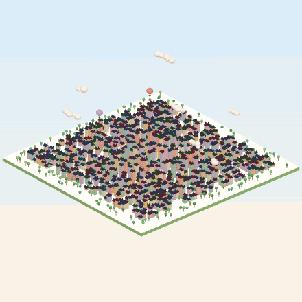
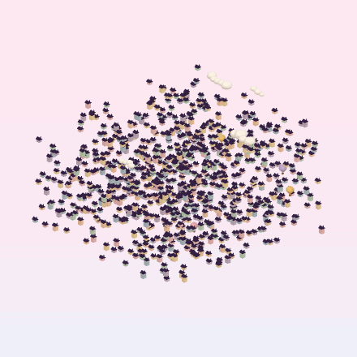

# Magic QR 3D

**English** · [Italiano](README.it.md)

A tiny 3D neighbourhood that looks like an ordinary toy town… until you tap it.
The scene turns smoothly to the one angle where all the rooftops line up into a **scannable QR code**.

<p align="center">
  
  
</p>

Try it: **https://giovannibishara.github.io/magic-qr-3d/** <!-- update if your GitHub username differs -->

## Features

- Type any text or link: the QR is generated in the browser with error correction level **H** (30% recoverable).
- Every dark module of the QR becomes a building. From the side it is a town (or a cloud of floating houses); from above it is a flat, crisp QR code.
- **Tap / click** the scene → it rotates to the magic view. Tap again → back to 3D. **Drag** to look around (with inertia); releasing near the top snaps to the magic view.
- 3 shapes (houses with doors, flower boxes and chimneys; towers with shops; cubes), 2 layouts (city on a base, floating), 6 colour themes, "shuffle" for new heights.
- Trees, drifting clouds and hot-air balloons liven up the 3D view, then shrink away as you approach the magic view so they never cover the code. When the QR appears, the houses do a little hop (straight up and down, so the code stays readable).
- Exports: **PNG** of the magic view (print-ready, 1600 px), looping **GIF**, short **video** (MP4 or WebM, depending on the browser).
- Shareable links: every setting is stored in the URL, e.g. `?text=https://example.com&shape=cubi&layout=sparsa&theme=lago`.
- Smooth on phones: all buildings are drawn with two `InstancedMesh` (two draw calls), and the page only renders when something moves.
- Italian / English interface. No build step, no tracking.

## How it works

The camera is **orthographic** (no perspective). With an orthographic camera looking straight down, every point on the same vertical line lands on the same pixel. So each building can have any height, or float at any altitude, and its roof still covers exactly its QR module when seen from the top.

From any other angle those different heights shuffle the pattern and the code is unreadable. The roof of each building covers exactly one full module (1 × 1), the roofs are dark and the ground is light, so the top view is a standard QR with a 4-module quiet zone.

```
QR module (row r, col c) ──► building at x = c, z = r, with random height / altitude
magic view = camera pitch 90°, yaw 0°  ──► roofs = QR
```

`test.html` checks this automatically: for every shape × layout × theme it renders the magic view and decodes it with [jsQR](https://github.com/cozmo/jsQR), and it also checks that a tilted view does **not** decode.

## Run it locally

You need [Node.js](https://nodejs.org) (only for the tiny local server; the page itself is static).

```bash
npm start
```

Open `http://localhost:5050`. The terminal also prints an address like `http://192.168.x.x:5050` to open the page from a phone on the same Wi-Fi.

To update the bundled libraries in `vendor/`: `npm install` then `npm run vendor`.

## Publish on GitHub Pages

Repository → **Settings** → **Pages** → *Deploy from a branch* → `main` / `(root)` → **Save**.
After a minute the site is at `https://<username>.github.io/magic-qr-3d/`.

## Project structure

```
index.html        page and controls
css/style.css     layout (bottom sheet on phones, side panel on desktop)
js/scene.js       three.js scene, camera, input, animation
js/qr.js          text → QR matrix
js/decor.js       trees, clouds, balloons
js/themes.js      colour themes
js/export.js      PNG / GIF / video export
js/i18n.js        Italian and English texts
test.html         automatic scan test
scripts/          local server and vendor script
vendor/           three.js, qrcode-generator, gifenc, jsQR (with their licenses)
```

## Tips for printing

- Use the **PNG** export, not a screenshot of the 3D view.
- Keep the white border around the code; print at least 2.5 × 2.5 cm.
- Always test the printed copy with two or three different phones.

## Credits

Original code and graphics by Giovanni Bishara. The general idea of an "anamorphic" QR code, readable from one viewpoint only, is an old optical trick; nothing in this project is copied from other products.

Libraries: [three.js](https://threejs.org) (MIT), [qrcode-generator](https://github.com/kazuhikoarase/qrcode-generator) (MIT), [gifenc](https://github.com/mattdesl/gifenc) (MIT), [jsQR](https://github.com/cozmo/jsQR) (Apache-2.0, test page only).
"QR Code" is a registered trademark of DENSO WAVE INCORPORATED.

## License

[MIT](LICENSE)
